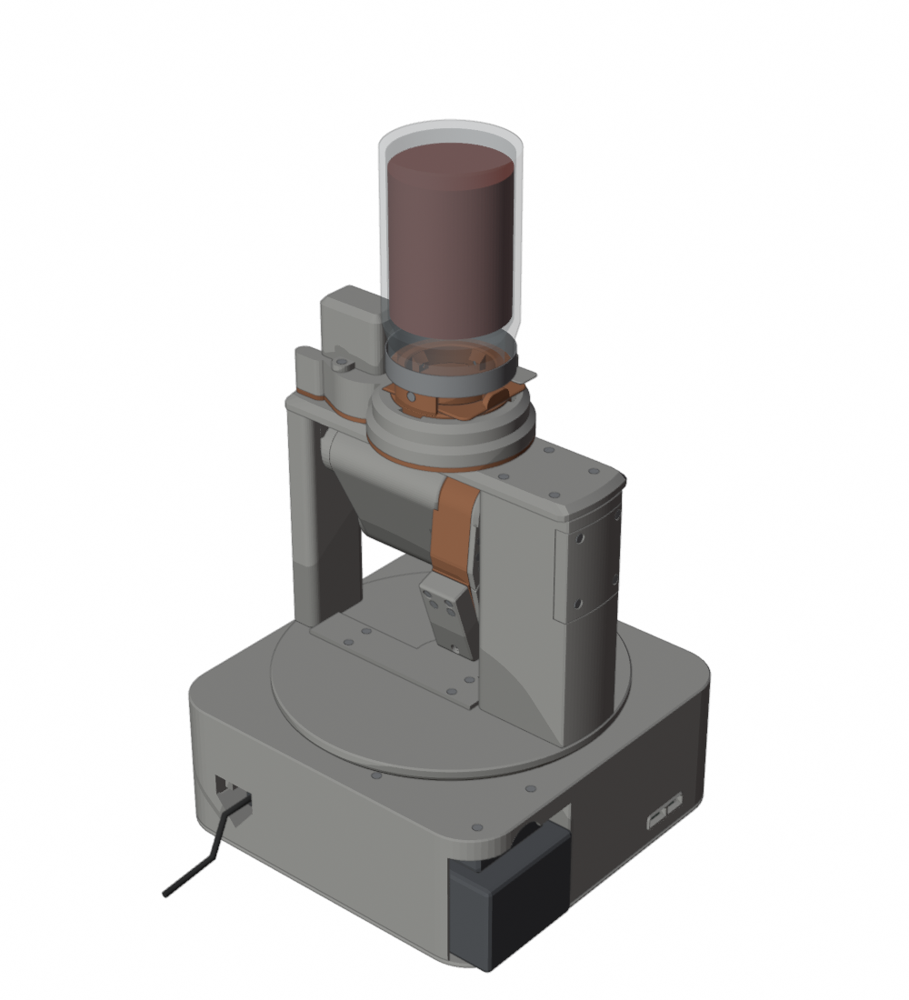
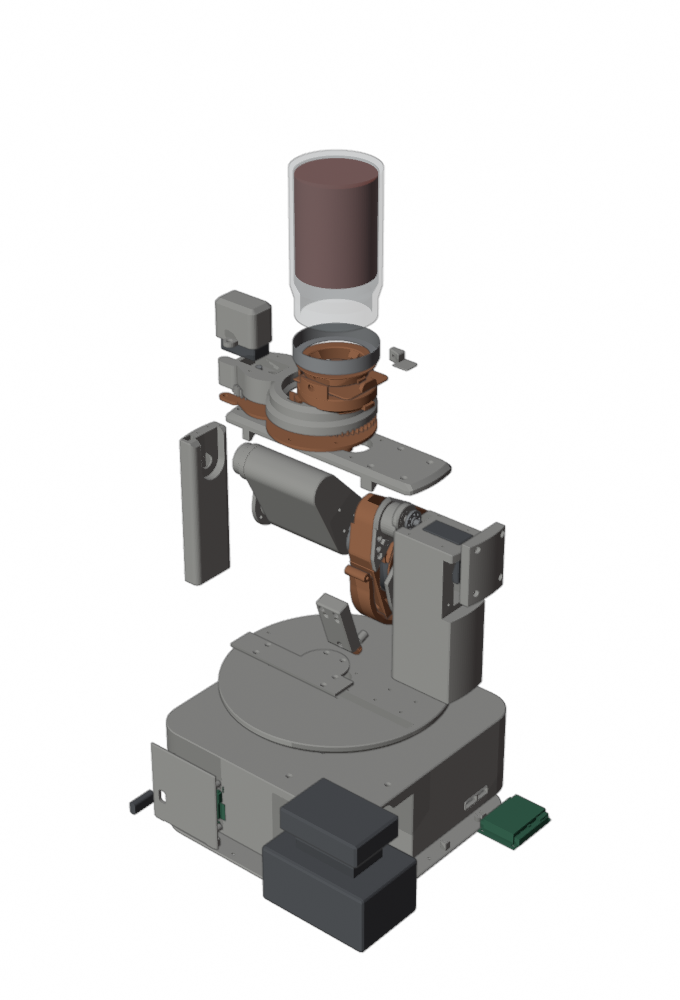
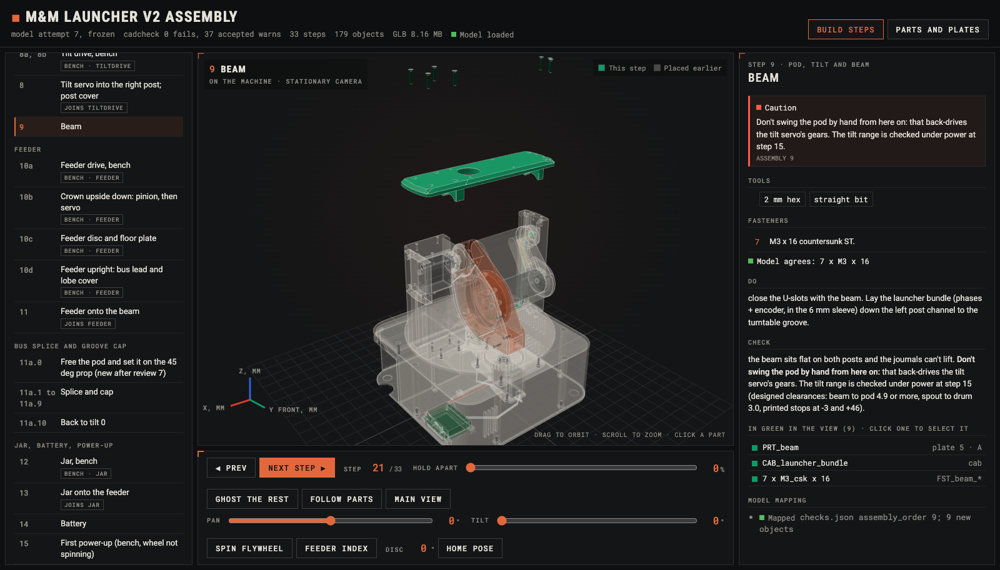
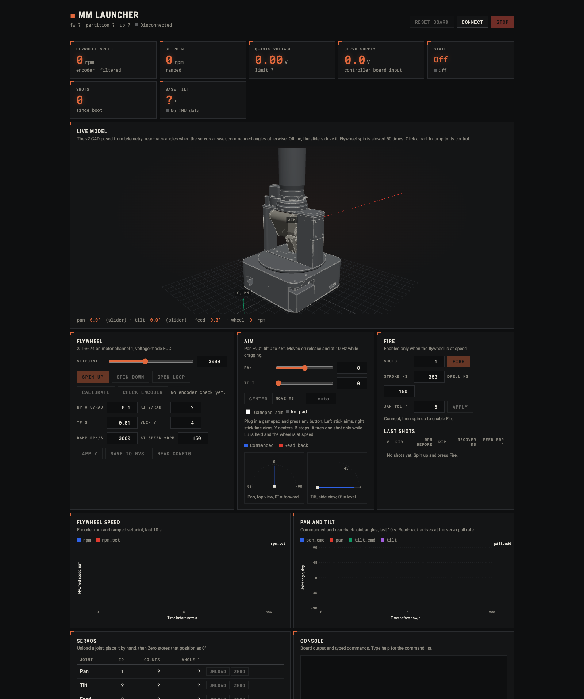

# M&M Launcher

A desktop pan/tilt turret that fires M&Ms. The candy rides in an upside-down mason jar. A feeder meters one M&M at a
time into a spinning flywheel, which launches it at an adjustable speed. You drive it from a browser over WebUSB, and the
browser shows the CAD moving live.

<p align="center">
  
  
</p>

| Path | What |
|---|---|
| [`mm-launch-hw/v2/`](mm-launch-hw/v2) | **Current hardware.** v2: modular Blender/cadlib model, BOM, design log, review renders, and the bench build package in [`BUILD/`](mm-launch-hw/v2/BUILD) |
| [`mm-launch-hw/`](mm-launch-hw) | v1 (attempts 1-3), the original design brief, purchased-part references, and the launch test rig in [`test-prints/launch-rig/`](mm-launch-hw/test-prints/launch-rig) |
| [`mm-launch-fw/`](mm-launch-fw) | MotorGo Axis (ESP32-S3) firmware and the WebUSB control panel |
| [`orchestration/`](orchestration) | The design/review loop that produced v2 |
| branch [`min-hardware`](../../tree/min-hardware) | v3: the same machine, assembled with snaps, slides and printed pins instead of screws |

## Hardware

- **Hopper:** a regular-mouth pint mason jar hangs upside down over the feeder. A printed adapter replaces the lid, and a
  slide gate lets you lift the jar off to refill it without spilling.
- **Feeder:** an indexing disc driven by a bus servo drops exactly one M&M per fire command.
- **Launcher:** an XTEAM XTI-3674 BLDC drives a taped flywheel against a sprung, adjustable nip. A Plink MT6701 encoder sits
  on the motor's rear shaft. The geometry matches the physical launch test rig.
- **Aim:** a pan turntable and a tilt yoke, each driven by a Hiwonder bus servo.
- **Power:** a DeWalt 20 V battery feeds a 12 V buck. The battery sits in the base for a low centre of gravity.
- **Prints:** PLA only, no supports, sized for a Bambu P1S and H2D.

v2 is frozen at attempt 7: review scores 9/8/9 (functionality/manufacturability/aesthetics), and `cad check` reports 0
fails with 37 accepted warns. It has 36 printed parts and 103 screws.

## Assembly

[`mm-launch-hw/v2/BUILD/`](mm-launch-hw/v2/BUILD) is the bench package:

| File | What |
|---|---|
| [`ASSEMBLY.md`](mm-launch-hw/v2/BUILD/ASSEMBLY.md) | Step-by-step assembly, in the order the CAD checks tested tool access |
| [`MEASURE_FIRST.md`](mm-launch-hw/v2/BUILD/MEASURE_FIRST.md) | Nominal values to caliper before printing (jar, servo horn, MotorGo holes) |
| [`SHOPPING_LIST.md`](mm-launch-hw/v2/BUILD/SHOPPING_LIST.md) | What to buy, counted from the model |
| [`PRINT_PLAN.md`](mm-launch-hw/v2/BUILD/PRINT_PLAN.md) | 9 plates, about 28 h of printing and 1.7 kg of PLA (geometry estimates), STLs per plate in `plates/` |
| [`guide/assembly_guide.html`](mm-launch-hw/v2/BUILD/guide/assembly_guide.html) | Interactive 3D assembly guide |

The interactive guide walks the 33 build steps. Each step flies its new parts in along their insertion path and lists
cautions, tools and fasteners. The guide checks the fastener counts against the model, and you can pan, tilt, spin the
flywheel and index the feeder. Download the HTML and open it in Chrome. It is self-contained except for three.js, which
it loads from a CDN.



## Control panel

[`mm-launch-fw/web/launcher.html`](mm-launch-fw/web/launcher.html) drives the turret over WebUSB:

- live 3D model of the v2 CAD, posed from servo read-back (offline, the sliders drive it);
- flywheel: setpoint, spin up/down, calibration, encoder check, and FOC gains saved to NVS;
- aim: pan/tilt sliders, gamepad aim, and top/side angle dials;
- fire: shot count, stroke/dwell timing, jam tolerance, and a last-shots table (rpm dip and recovery). Fire is only
  enabled once the flywheel is at speed;
- charts: flywheel rpm and joint angles over the last 10 s;
- servos: unload, position by hand and zero each joint, plus a board console and firmware update over USB.



Serve it from localhost, because WebUSB needs a secure context:

```
cd mm-launch-fw/web && python3 -m http.server 8000   # open http://localhost:8000/launcher.html in Chrome
```

Build, flash and wiring instructions are in [`mm-launch-fw/README.md`](mm-launch-fw/README.md).

## How it was designed

The hardware is code. Each subsystem is a Python module that builds into a Blender assembly with the `cadlib` helpers from
alex-3d-skills. `cad check` then tests interference over every joint sweep, tool access for each screw at its assembly step,
drop paths, indexer timing, tip stability and print orientation. Each attempt was planned, built per subsystem and then
scored by an independent reviewer: [`orchestration/v2-loop.workflow.js`](orchestration/v2-loop.workflow.js). Reviews are in
`mm-launch-hw/v2/renders/attempt-*/review.md`.
